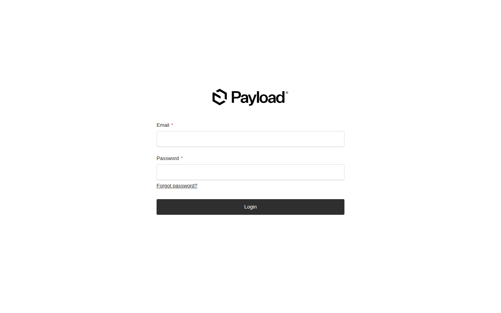
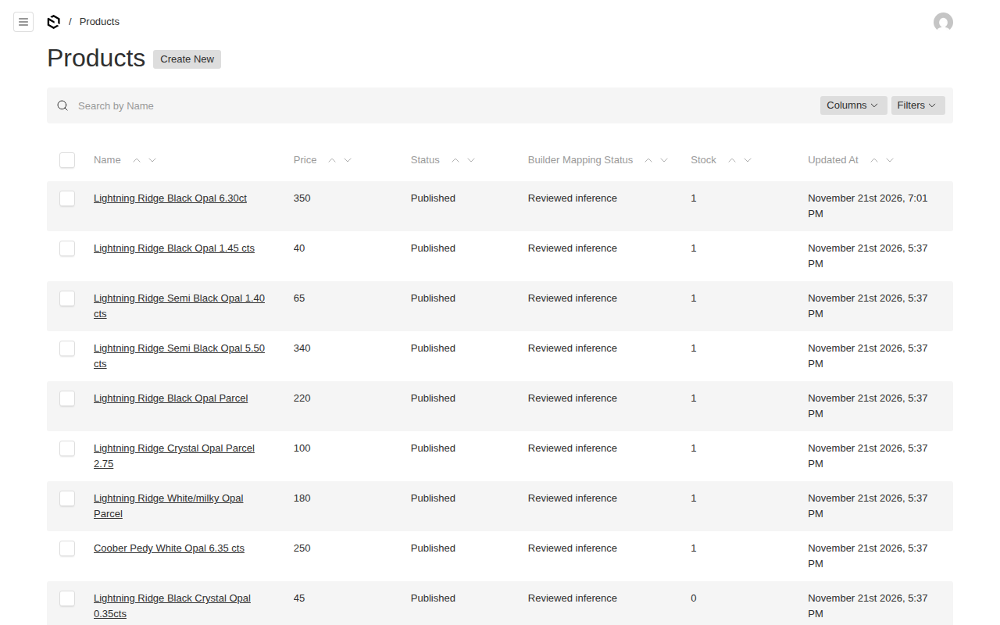
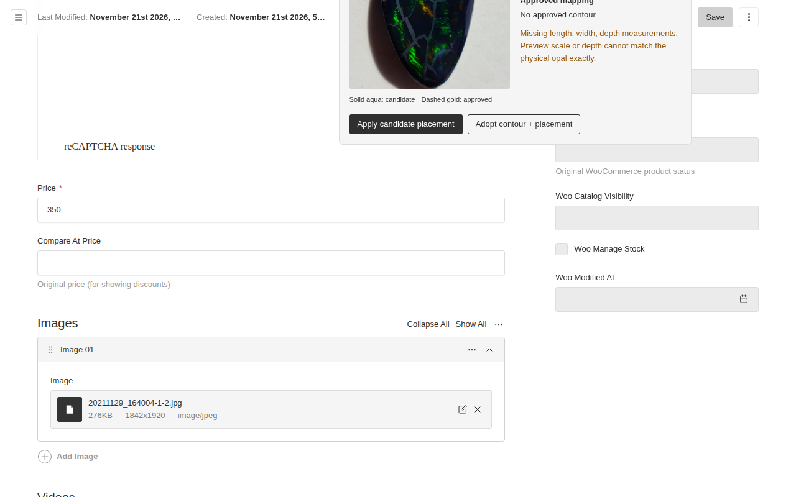
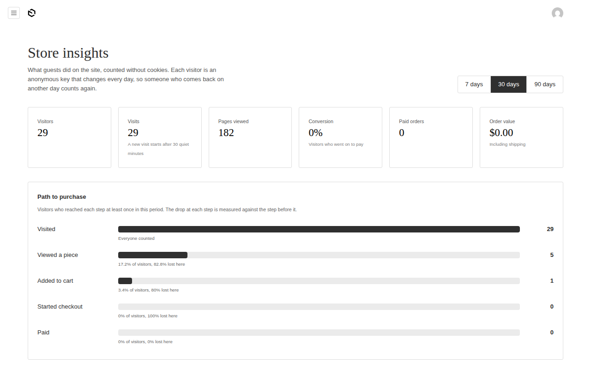

# Running The Good Opal Co: a guide for Steph

This guide covers the everyday jobs on the new goodopalco.com, roughly in the order you will need them. Each section is short. If something here does not match what you see on screen, or a job you need is not covered, ask Dylan.

The guide uses the names you will see in the admin. The admin is the private back office where you add pieces, see orders and answer enquiries.

## 1. Logging in

1. Go to https://goodopalco.com/admin.
2. Enter your email address and password.
3. If you forget your password, use the "Forgot password?" link on the login screen. A reset link is emailed to you.

Only accounts set as **Admin** can use the admin. To add another person, ask Dylan.

Your past WooCommerce orders were not copied into the new admin, so the Orders list starts empty. After the switch-over, the old shop lives at https://old.goodopalco.com/wp-admin. It is in coming-soon mode with payments turned off, and it stays there so you can look up past orders and customers.

### Finding your way around

The menu down the left side groups everything:

- **Collections**: Products (your pieces), Media (every photo and video), Reviews, Posts (the blog), Categories, Tags, Authors and Users. Ring Assets, Ring Designs and Ring Reference Checks belong to the ring designer; leave them alone.
- **E-commerce**: Orders, and Inventory Reservations (pieces held while someone is paying). Commerce Import Runs is a technical record of the move from the old shop.
- **CRM**: Customers, Enquiries and Custom Quotes. Custom Quote Events is a history log you never need to edit.
- **Education**: Courses.
- **Insights**: Insight Events, the raw visit records behind Store insights.
- **Reports**: Store insights, your shop dashboard (see section 11).

## 2. Where to edit your pieces

Make every change to your pieces in the new admin. The old shop is no longer used for products.

The new site has an automatic copy from the old shop, and it is switched off. If it is ever turned back on, it overwrites your edits to names, descriptions, prices, stock and photos, so check with Dylan first.

## 3. Adding a new piece

### Step by step

1. Click **Products**, then **Create New**. The list shows each piece's price, status and stock at a glance.

   

2. **Name**: the name buyers see, for example "Lightning Ridge black opal ring".
3. **Slug**: the end of the piece's web address. Use lower case words joined by hyphens, for example `lightning-ridge-black-opal-ring`. Every piece needs a different slug. Do not use the word "deposit" in it, because pieces with "deposit" in the slug are kept out of the shop.
4. **Description**: write about the piece. Two things are worth knowing:
   - A short line written as "Label: value", for example "Setting: Sterling silver", is shown in the piece's details table instead of as a paragraph. "Inclusions: ..." becomes its own row too.
   - The page stops showing the description at the first paragraph that starts with "Please note", "Priced in AUD", "All images and videos are taken", "If you have any queries" or "Message sent". Put anything you want buyers to read above those.
   - If you include the sentence about photos being taken under white light and not edited, the page shows: "Photographed under white light. Studio shots have the background replaced; the stone is never retouched." Only include it when it is true for that piece.
5. **Price**: the full price in Australian dollars, exactly what the buyer pays for the piece. The site does not add GST or show GST separately. If you need GST shown on prices or receipts, ask Dylan before launch.
6. **Compare At Price** (the original price): only fill this in for a genuine reduction. The shop then shows the old price crossed out and "Save X%". Leave it empty otherwise.
7. **Category**: choose one of Opal Rings, Opal Necklaces & Pendants, Opal Earrings, Opal Bracelets, Raw Opals or Custom Commissions.
8. **Stock**: how many you have. For a one-of-a-kind piece, enter **1**. The page then says "One of a kind" and "This exact stone is the one you receive." 0 means sold.
9. Fill in the details that apply. Each one appears on the piece's page:
   - **Material** (for example Sterling Silver or 18K Gold, or "None (Raw Opal)").
   - **Stone type** (Black, White, Boulder, Crystal, Fire, Matrix, Opal Doublet or Opal Triplet).
   - **Stone origin** (Lightning Ridge, Coober Pedy and so on).
   - **Dimensions** in millimetres.
   - **Weight**, with its unit (carats or grams). The weight is only shown on finished jewellery once the unit is chosen.
   - **Ring size** (only appears for rings).
   - **Care instructions**.
   - **Certified**, with the certificate number. Only tick it if the piece really has a certificate.
   - **Sold per unit, chosen at random**: tick this only for a listing where the buyer gets one of several similar stones that you pick for them, rather than the exact stone in the photos. The page then stops saying "This exact stone is the one you receive."
10. **Sku**: your own stock code, optional. It must be different for every piece.
11. Add photos and any videos (see below).
12. Leave **Status** on **Draft** while you work. Click **Save**.
13. When it is ready, change **Status** to **Published** and click **Save** again. The piece appears in the shop straight away.

**Featured**: tick this to move the piece to the front. The home page lists featured pieces first, then the rest by price.

**Tags** are optional words for your own use and for search.

### Photos

1. In the **Images** section, click **Add Image**, then upload a photo or choose one already in Media.
2. **Alt** (alt text) is required for every photo. You fill it in when you upload; for a photo already added, click the pencil icon next to it. Describe what the photo shows for someone who cannot see it, for example "Black opal ring, front view, green and blue flashes". If it is missing, the site falls back to the piece's name and a number, which helps nobody.
3. **Order matters.** The first photo is the one on the shop card, in search results and when someone shares the link. Drag the rows by the dotted handle to reorder them.

   

4. Upload the original photo from your camera or phone, not a screenshot. The site makes the smaller versions itself.
5. **Never colour-edit a stone photo.** No filters, warming, saturation, brightness tricks or "enhance" buttons on the stone. Replacing the background is fine; the stone itself must look exactly as it does in white light. Buyers are paying for that colour.

### Videos

1. In the **Videos** section, add a row and upload an MP4 or WebM clip. Short clips of the stone moving in the light work best: ideally under 15 seconds and under 10 MB.
2. Add a **Poster image**: a still photo of the same stone, shown before the clip plays.
3. Videos appear after the first photo, muted and looping. The same no-colour-editing rule applies.

### Draft, Published and Archived

- **Draft**: only you can see it.
- **Published**: live in the shop.
- **Archived**: hidden everywhere, including the sold pieces page. Use it for pieces you never want shown again.

### Raw opals and the ring designer

Raw opal listings have extra sections for the custom ring designer ("Ring builder: opal mapping review" and "Ring builder: visual overrides"), and a folded "Old shop record" section left over from the old shop. These are technical settings that decide whether a stone can be shown in the designer. Leave them alone and ask Dylan if you want a stone added to the designer.

## 4. When someone buys

Here is what happens, in order:

1. The buyer adds the piece to their cart and checks out. They choose Australia or overseas first, so the right postage is charged:
   - Australia: $15.
   - Overseas (New Zealand, United States, United Kingdom, Canada, Singapore, Hong Kong and Japan): $25.
   - Postage is free on orders of $500 or more.
2. The site sends them to **Stripe** to pay. Stripe collects their card, phone number and delivery address.
3. As soon as they reach Stripe, the piece is **held** for them. Its stock drops, and the page shows **Reserved**: "Someone is checking out with this piece. If they don't complete payment, it returns to the shop within 30 minutes." You can see holds under **Inventory Reservations**. You cannot change them; they look after themselves.
4. If they do not pay, the hold ends after about half an hour and the piece goes back on sale by itself.
5. If they pay:
   - An order appears under **Orders**, with a number starting **OPAL-** and status **Processing**.
   - The buyer gets an email: "Order confirmation - OPAL-...".
   - You get an email at the shop's contact address: "New order - OPAL-...". It lists the items, the buyer and the delivery address, and has a link to the order in the admin. Replying to it goes straight to the buyer.
   - The buyer is added to, or updated in, **Customers**.
   - The piece now shows as **Sold**.
6. Rarely, an order arrives with status **Pending** and your email says "Inventory review required". This means the stock did not line up as expected (for example, two people paid for the same piece). Check the order's notes and stock before posting anything, and ask Dylan if it is unclear.

A piece with an open checkout hold cannot be deleted.

## 5. Posting an order

1. Open **Orders** and click the order.
2. Pack and post it.
3. Set **Status** to **Shipped**.
4. Choose the **Shipping carrier** (Australia Post, StarTrack, DHL, FedEx or Other) and enter the **Tracking number**.
5. Click **Save**.

The buyer is emailed "Your order OPAL-... has shipped" with the tracking details. This email goes once only, and only when the status is Shipped and a tracking number is filled in. If sending fails, the error shows on the order; saving again retries it.

Buyers can also check their order at goodopalco.com/order-tracking using their order number and email.

**Delivered** and **Cancelled** are for your records only. They send no emails. Cancelling does not refund the buyer or put the piece back on sale. See the next section for that.

Use **Notes** on an order for anything private. Buyers never see it.

## 6. Refunds, disputes and payouts

All money is handled in your **Stripe dashboard**, not in the admin.

### Refunds

1. Find the payment in Stripe and refund it (in full or in part).
2. Stripe tells the site, and the order updates itself:
   - **Full refund**: the order changes to **Refunded**, and the piece's stock goes back up by one, so **it goes back on sale**. If the piece is not coming back to you, set its stock to 0 or archive it.
   - **Partial refund**: the order keeps its status, a note records the refund, and stock is not changed.

The admin will not let you set an order to Refunded by hand. Refund in Stripe first.

### Disputes (chargebacks)

If a buyer disputes a payment with their bank, the order changes to **Disputed**. Answer the dispute in Stripe. If Stripe rules in your favour, the order goes back to its earlier status.

### Payouts

Stripe pays your takings into your bank account. Check payout dates and amounts under Payouts in the Stripe dashboard.

## 7. Sold pieces

When a piece's stock reaches 0 (and nobody is mid-checkout), its page stays up and shows **Sold** with "This piece has found a home.", plus links to similar pieces and to ask you to find one like it.

Sold pieces are hidden from the main shop list unless a visitor ticks "Include sold pieces". They also appear on the **Recently sold** page (goodopalco.com/store/collected), newest first, up to 48 pieces.

To remove a sold piece from the site completely, set its status to **Archived**.

## 8. Enquiries and video viewings

Every message sent through the contact form lands in **Enquiries**, with a reference starting **ENQ-**.

- You get an email at the shop's contact address with the reference and topic in the subject, for example "[ENQ-...] Product viewing". Replying goes straight to the customer.
- The customer gets "ENQ-...: We received your enquiry".
- The sender is also added to **Customers**, tagged with what they asked about.

The **Type** tells you what it is about: General question, Custom jewellery, Product viewing, Product question, Order support, Return or exchange, Wholesale or trade, or Course or workshop interest.

**Video viewings**: each piece's page has a "Book a video viewing" link. It opens the contact form already set to Product viewing, and the enquiry shows which piece. Reply to arrange a time. The site does not book calls by itself.

### Working through an enquiry

1. Open it and read it.
2. Reply by email.
3. Change the **Status** as it moves along: New, Reviewing, Awaiting customer, Consultation, and finally Completed or Declined. Use **Spam** for junk.
4. Keep private notes in **Internal notes**.

The statuses Quoted, Accepted, Deposit paid and In production are set by the quote process below. The admin will refuse them until a matching quote exists.

## 9. Custom designs and quotes

### Where requests come from

- The contact form, with the type "Custom jewellery".
- The ring designer on the Services page. These enquiries also show a summary of the design the customer put together. The exact settings are kept in the folded "Ring designer data" section; leave that alone.

Both land in **Enquiries**.

**Requests by phone, email or Instagram**: a quote must be attached to an enquiry, so create one first. Go to **Enquiries**, click **Create New**, fill in the customer's name, email and what they asked for, choose the type **Custom jewellery**, set the source to **Manual** and save. The ENQ- reference fills itself in. Then send the quote as below.

### Sending a quote

1. Go to **Custom Quotes** and click **Create New**.
2. **Enquiry**: choose the customer's enquiry. Their email is filled in from it.
3. **Quote total (AUD)**: the full quoted price in dollars, for example 1250 or 1250.50.
4. **Deposit (AUD)**: the deposit in dollars. Enter 0 for no deposit.
5. **Valid Until**: the date the offer ends. The link stops working after this.
6. **Terms**: exactly what is included: the stone, metal, sizing, timing, what is not included, and cancellation terms. The customer agrees to this text.
7. Leave **Quote Number**, **Quote Series Id**, **Revision** and **Customer Email** alone; they fill themselves in.
8. Click **Save**, then **Send / retry quote**.

The customer receives "Your custom jewellery quote – QUOTE-..." with a private link. Only that link opens the quote. Do not forward it to anyone else.

### Once it is sent

- The terms and amounts can no longer be changed. To change anything, create a new quote, choose the old one under **Supersedes**, and send it. It becomes the next revision (R2, R3 ...) and the old one is marked as replaced.
- If the email failed, the error shows on the quote. Press **Send / retry quote** again.
- A quote cannot be sent after its valid-until date, and quotes cannot be deleted.

### When the customer accepts and pays

1. The customer opens the link, ticks the agreement box and accepts. The quote and the enquiry both change to **Accepted**.
2. If there is a deposit, they pay it through Stripe. The quote shows the deposit as paid, the enquiry changes to **Deposit paid**, and the customer gets "Deposit confirmed – QUOTE-...".
3. Move the enquiry to **In production** when you start, and **Completed** when it is done.

You are emailed at each step: "Quote accepted - QUOTE-..." when the customer accepts, and "Deposit paid - QUOTE-..." when the deposit arrives.

Refund a deposit in Stripe, the same as an order.

## 10. Reviews, blog posts, courses and other pages

### Reviews

1. Go to **Reviews**, then **Create New**.
2. Only add reviews customers actually wrote. Copy their words exactly.
3. **Author name**: first name and last initial only, for example "Sam T.".
4. Add the **date** they wrote it and the **source** (for example goodopalco.com, Google, Etsy or Instagram), plus a link to the original if there is one.
5. **Rating**: only if they gave stars. Leave it empty otherwise.
6. **Product**: choose the piece if the review is about one. It then shows on that piece's page under "From the person who bought it."
7. Set **Status** to **Published** and save.

### Blog posts

1. Go to **Posts**, then **Create New**.
2. Fill in the **Title**, **Slug** (the web address), **Content**, an **Author** and at least one **Category**. Add a short **Excerpt** and a **Featured image** if you like.
3. Use **Save Draft** while writing and **Publish changes** when ready. Earlier versions are kept, so you can go back.

### Courses

Course outlines live under **Courses**. Set each one to Accepting interest enquiries, Coming soon or Closed. Interest comes in through the contact form as "Course or workshop interest".

### Newsletter

People who sign up are emailed a confirmation link, and they count as subscribers once they click it. You can see them in **Customers**. The admin has no way to write or send a newsletter. Ask Dylan if you want to start sending one.

### Pages that need Dylan

These pages are written into the site itself and cannot be edited in the admin:

- the home page text and the jeweller quotes on it
- About
- FAQ
- Shipping, Returns, Privacy and Terms
- Services and the ring designer

Send Dylan the new wording and he will update them. The postage prices and the free-postage threshold also need Dylan.

## 11. Seeing how the shop is doing

### Store insights

Click **Store insights** under Reports in the admin menu. Choose 7, 30 or 90 days at the top. It shows:

- **Visitors, visits, pages viewed, conversion, paid orders and order value** for the period.
- **Path to purchase**: how many visitors reached each step, from browsing to paying, and where they dropped off.
- **Why people aren't buying**: carts never taken to checkout, checkouts not paid, answers to the short question on the cart page, pieces looked at but never added to a cart, searches and filters that found nothing, the slowest pages, and errors visitors hit.
- **Where guests come from**: sites that sent visitors, tagged campaign links, and countries.
- **Pieces**: how often each piece was viewed, added to a cart and bought.
- **Follow up**: checkouts left unpaid, with the buyer's email if they typed it into Stripe before leaving.

Visits are counted without cookies. Each visitor is an anonymous code that changes daily, so someone who comes back the next day is counted again. Detailed visit records are cleared out on a schedule.

### Microsoft Clarity

Microsoft Clarity is connected to the site. At https://clarity.microsoft.com you can watch anonymous recordings of visits and see heatmaps of where people click. It only records visitors who accept analytics cookies, and never on quote pages. Ask Dylan for access.

### Stripe

Your Stripe dashboard is the record of money: payments, refunds, disputes and payouts.

## 12. Emails the site sends

| When | Who gets it | Subject |
| --- | --- | --- |
| Someone pays | The buyer | Order confirmation - OPAL-... |
| Someone pays | You | New order - OPAL-... (or Inventory review required) |
| You mark an order Shipped with tracking | The buyer | Your order OPAL-... has shipped |
| Contact form sent | You | [ENQ-...] and the topic |
| Contact form sent | The customer | ENQ-...: We received your enquiry |
| You press Send / retry quote | The customer | Your custom jewellery quote – QUOTE-... |
| Customer accepts a quote | You | Quote accepted - QUOTE-... |
| Deposit paid | The customer | Deposit confirmed – QUOTE-... |
| Deposit paid | You | Deposit paid - QUOTE-... |
| Newsletter sign-up | The subscriber | A newsletter confirmation, with a link to confirm |

Your copies go to the shop's contact email address. To change that address, ask Dylan.

## 13. Please don't

- **Don't colour-edit stone photos or videos.** No filters, tints, saturation or "enhance". The stone must look as it does in white light.
- **Don't change the slug of a live piece** without asking Dylan. It breaks links people have shared and saved, and some older pieces' photos are matched by slug.
- **Don't publish anything that isn't true.** Every review must be real and word for word. Every certificate, origin, weight, discount and "one of a kind" claim must be accurate.
- **Don't set Refunded by hand.** Refund in Stripe and let the order update itself.
- **Don't delete pieces or orders.** Archive a piece instead. Orders are your records.
- **Don't change the raw opal designer settings.**
- **Don't share quote links.** Each one belongs to one customer.

## 14. Who to ask

Ask Dylan for anything not covered here, including new admin accounts, page wording, postage prices, GST on prices, newsletters, the ring designer and anything that looks wrong.
